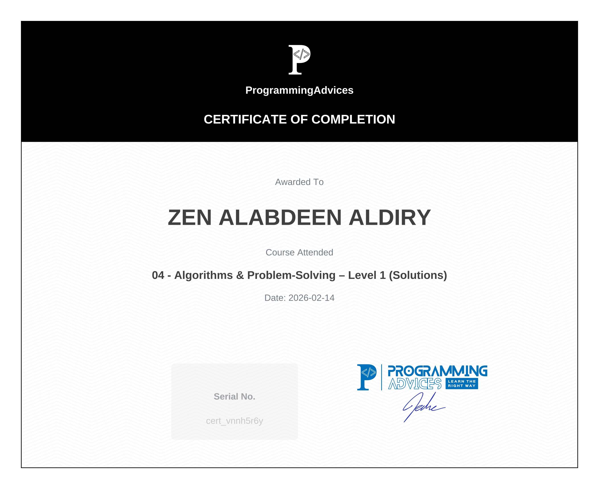
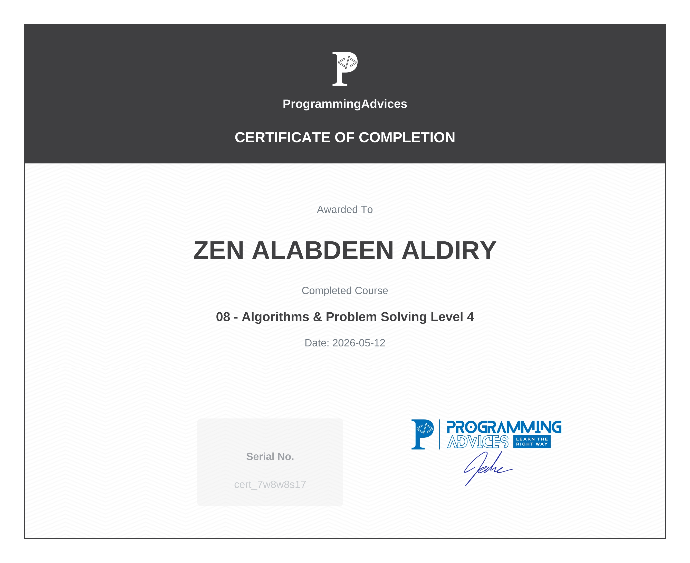
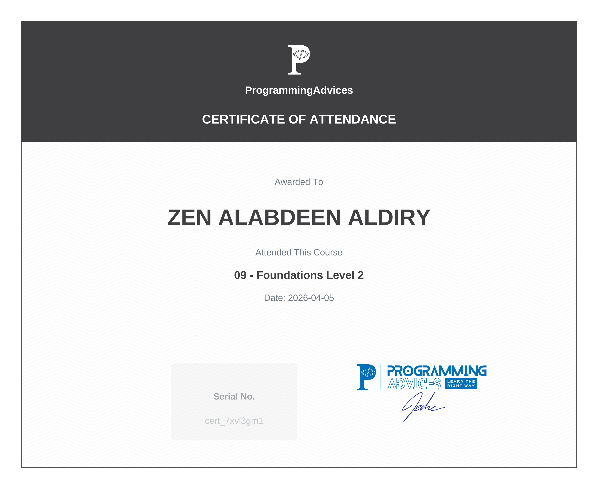
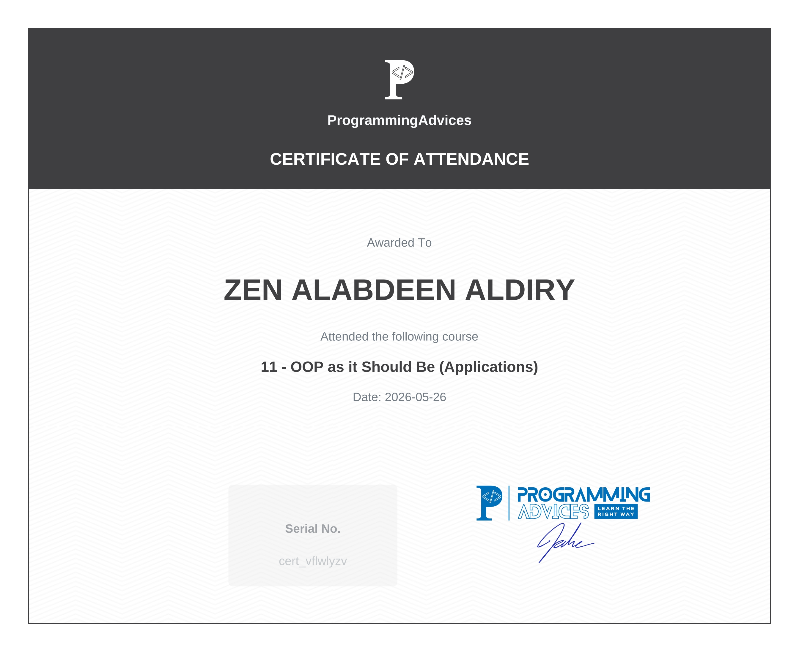
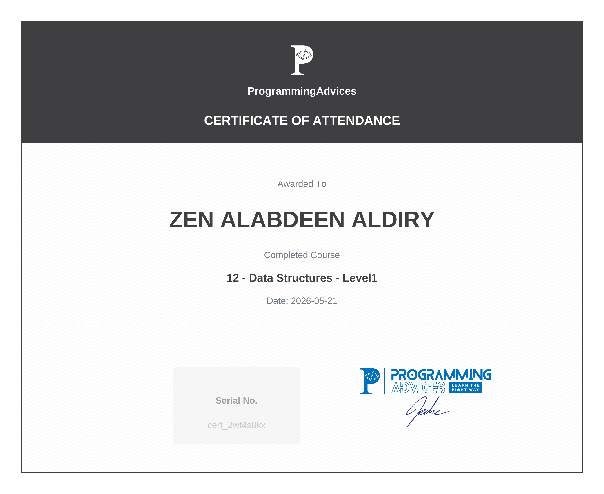
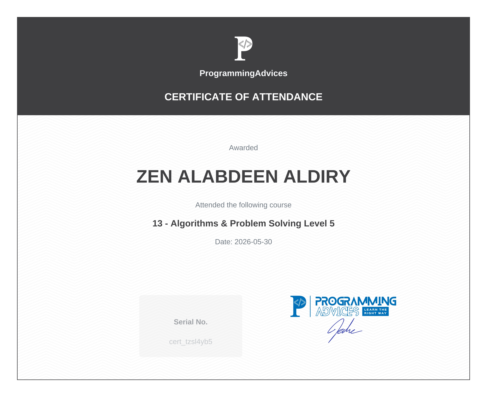

# 🎓 Stage 1: Computer Science, Algorithms & Programming Foundations

This repository contains all official completion certificates for **Stage 1** of the Programming Advices roadmap, successfully verified and completed.

---

## 📜 Certificates Gallery

1. **Course 01: Programming Foundations - Level 1**  
   

2. **Course 02: Algorithms & Problem-Solving Level 1**  
   

3. **Course 03: Introduction to Programming with C++ – Level 1**  
   

4. **Course 04: Algorithms & Problem-Solving – Level 1 (Solutions)**  
   

5. **Course 05: Algorithms & Problem-Solving – Level 2**  
   

6. **Course 06: Introduction to Programming Using C++ Level 2**  
   

7. **Course 07: Algorithms & Problem Solving Level 3**  
   

8. **Course 08: Algorithms & Problem Solving Level 4**  
   

9. **Course 09: Foundations Level 2 (Computer Networks & Internet)**  
   

10. **Course 10: OOP as it Should Be (Concepts)**  
    

11. **Course 11: OOP as it Should Be (Applications)**  
    

12. **Course 12: Data Structures - Level 1**  
    

13. **Course 13: Algorithms & Problem Solving Level 5**  
    

---
> *Certified by Dr. Mohammed Abu-Hadhoud / Programming Advices*
